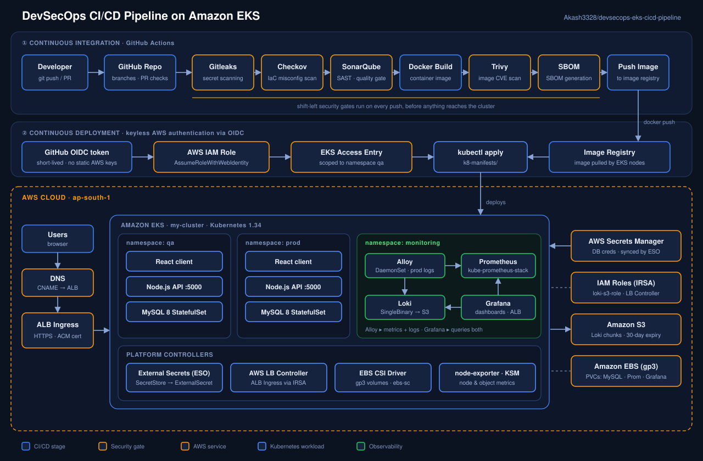

<div align="center">

# DevSecOps CI/CD Pipeline on Amazon EKS

**A multi-tier application (React + Node.js + MySQL) shipped to Kubernetes through a security-gated GitHub Actions pipeline, with keyless AWS authentication, managed secrets, and a full Prometheus / Loki / Alloy / Grafana observability stack.**


<br/>



<sub>**Live architecture:** moving dots show data flowing through the four phases: **① build & secure → ② authenticate & deploy → ③ run on EKS → ④ observe**. Stages light up in order, left to right.</sub>

</div>

---

## Table of Contents

1. [Overview](#overview)
2. [Key Features](#key-features)
3. [Architecture](#architecture)
4. [Tech Stack](#tech-stack)
5. [Repository Structure](#repository-structure)
6. [Prerequisites](#prerequisites)
7. [Getting Started](#getting-started)
8. [CI/CD Pipeline](#cicd-pipeline)
9. [Secrets Management](#secrets-management)
10. [Observability Stack](#observability-stack)
11. [Verification Checklist](#verification-checklist)
12. [Troubleshooting & Lessons Learned](#troubleshooting--lessons-learned)
13. [Security Considerations](#security-considerations)
14. [Roadmap](#roadmap)
15. [Cleanup](#cleanup)
16. [Author](#author)

---

## Overview

This project demonstrates an end-to-end **DevSecOps workflow** on AWS: code is pushed to GitHub, passes through automated security and quality gates, is built into a container image, and is deployed to an **Amazon EKS** cluster, all without a single long-lived AWS credential stored in GitHub.

Once running, the workload is observed by a self-hosted monitoring stack: **Prometheus** for metrics, **Loki** (backed by **S3**) for logs, **Grafana Alloy** as the collection agent, and **Grafana** for visualization, exposed securely over HTTPS through an AWS Application Load Balancer.

**What this project is meant to show:**

- Security shifted left into the pipeline (secrets, IaC, code, image and supply-chain scanning)
- Passwordless, short-lived cloud access using GitHub OIDC + IAM roles
- Least-privilege access to the cluster (EKS Access Entry scoped to a single namespace)
- Secrets pulled from AWS Secrets Manager at runtime, never committed to Git
- Stateful workloads on Kubernetes (MySQL StatefulSet on EBS)
- A production-style observability setup, debugged and verified end to end

---

## Key Features

| Area | What's implemented |
|---|---|
| **CI/CD** | GitHub Actions workflows (`.github/`) that build, scan and deploy |
| **Shift-left security** | Gitleaks (secrets), Checkov (IaC), SonarQube (SAST / quality gate), Trivy (image CVEs), SBOM generation |
| **Keyless auth** | GitHub OIDC → IAM Role (`AssumeRoleWithWebIdentity`), trust policies in `github-oidc-trust-policy-qa.json` / `qa-oidc-trust-policy.json` |
| **Least privilege** | EKS Access Entry scoped to the `qa` namespace |
| **Secrets** | AWS Secrets Manager + External Secrets Operator (`SecretStore` → `ExternalSecret`) |
| **Stateful data** | MySQL 8 as a `StatefulSet` with headless service and EBS-backed `volumeClaimTemplates` |
| **Ingress & TLS** | AWS Load Balancer Controller, ALB Ingress, ACM certificate, HTTP→HTTPS redirect |
| **Metrics** | `kube-prometheus-stack` (Prometheus, Alertmanager, node-exporter, kube-state-metrics) |
| **Logs** | Loki in SingleBinary mode, chunks and index stored in S3 via IRSA |
| **Collection** | Grafana Alloy DaemonSet: pod logs → Loki, annotated pod metrics → Prometheus (`remote_write`) |
| **One-command monitoring** | `Monitoring/deploy.ps1` provisions S3, IAM, IRSA and all four Helm releases idempotently |

---

## Architecture

The animated diagram above is the map of the whole system. The four numbered phases in it match the four sections below.

**① Build & secure (GitHub Actions)**
A push or pull request triggers the pipeline. The security gates run first: **Gitleaks** (leaked secrets), **Checkov** (IaC misconfigurations) and **SonarQube** (static analysis and quality gate). The app is then built into a container image, scanned with **Trivy**, an **SBOM** is generated, and the image goes to the registry.

**② Authenticate & deploy (keyless)**
The workflow requests a short-lived **GitHub OIDC token** and exchanges it for temporary credentials by assuming an **IAM role**. The role is mapped into the cluster through an **EKS Access Entry** limited to the `qa` namespace, and the manifests in `k8-manifests/` are applied with `kubectl`.

**③ Run on AWS (Amazon EKS)**
- **Application**: the `nodejs-app` Deployment (port 5000) and a `mysql` StatefulSet run in `prod`; the pipeline deploys to `qa`.
- **Traffic**: Users → DNS (CNAME) → ALB Ingress (HTTPS, ACM certificate) → Services. The AWS Load Balancer Controller provisions the ALB.
- **Secrets**: the External Secrets Operator syncs credentials from AWS Secrets Manager into Kubernetes Secrets.
- **Storage**: the EBS CSI driver provisions gp3 volumes through the `ebs-sc` StorageClass.

**④ Observe (`monitoring` namespace)**
Alloy tails pod logs (via the Kubernetes API) and scrapes annotated pod metrics in the `prod` namespace. Logs go to Loki through the nginx gateway and are stored in S3. Metrics are remote-written to Prometheus. Grafana queries both and is exposed over HTTPS through the ALB.

---

## Tech Stack

| Layer | Technology |
|---|---|
| Cloud | AWS (EKS, IAM, S3, EBS, Secrets Manager, ALB, ACM) |
| Orchestration | Kubernetes 1.34 on Amazon EKS (`eksctl`) |
| Application | React (client), Node.js (server), MySQL 8 |
| Containers | Docker |
| CI/CD | GitHub Actions with OIDC federation |
| Security scanning | Gitleaks, Checkov, SonarQube, Trivy, SBOM |
| Secrets | AWS Secrets Manager, External Secrets Operator |
| Packaging | Helm |
| Metrics | Prometheus (`kube-prometheus-stack` 67.4.0), Alertmanager |
| Logs | Loki 6.29.0 (SingleBinary, S3 backend) |
| Collection | Grafana Alloy 0.12.0 |
| Visualization | Grafana 8.10.4 (chart) |
| Automation | PowerShell (`deploy.ps1`) |

---

## Repository Structure

```text
devsecops-eks-cicd-pipeline/
├── .github/                          # GitHub Actions workflows (CI/CD pipeline)
├── client/                           # React front end
├── server/                           # Node.js API
├── k8-manifests/                     # Kubernetes manifests applied by the pipeline
├── Monitoring/                       # Observability stack (Helm values + deploy script)
│   ├── deploy.ps1                    #   one-shot, idempotent installer
│   ├── 01-prometheus-values.yaml     #   kube-prometheus-stack
│   ├── 02-loki-values.yaml           #   Loki (SingleBinary, S3)
│   ├── 03-alloy-values.yaml          #   Alloy pipelines (logs + metrics)
│   ├── 04-grafana-values.yaml        #   Grafana (ALB ingress, datasources)
│   └── 05-loki-s3-iam-policy.json    #   least-privilege S3 policy for Loki
├── Dockerfile                        # Container image build
├── .dockerignore
├── sonar-project.properties          # SonarQube project configuration
├── github-oidc-trust-policy-qa.json  # IAM trust policy for GitHub OIDC (qa)
├── qa-oidc-trust-policy.json         # IAM trust policy variant
├── secret-store-prod.yaml            # External Secrets: SecretStore (prod)
├── external-secret-prod.yaml         # External Secrets: ExternalSecret (prod)
├── mysql-statefulset-prod.yaml       # MySQL StatefulSet (prod)
├── mysql-svc-prod.yaml               # MySQL headless service (prod)
├── alloy-rendered.yaml               # Rendered Alloy manifest (reference/debugging)
└── docs/
    └── architecture.svg              # Architecture diagram
```

---

## Prerequisites

**Tooling** (the monitoring script checks for these automatically)

- `aws` CLI v2, authenticated (`aws sts get-caller-identity` works)
- `kubectl`, `helm`, `eksctl`
- PowerShell (Windows PowerShell 5.1 or PowerShell 7+) to run `deploy.ps1`
- Docker (for local image builds)

**AWS / cluster**

- An EKS cluster (examples use `my-cluster` in `ap-south-1`) with the **IAM OIDC provider** associated
- **EBS CSI driver** add-on installed, plus a StorageClass named `ebs-sc` (see below)
- **AWS Load Balancer Controller** installed (Helm + IRSA) for ALB ingress
- An **ACM certificate** and a DNS record you control for the Grafana hostname
- An AWS account with permission to create S3 buckets, IAM policies and roles

---

## Getting Started

> Replace the example values (`my-cluster`, `ap-south-1`, bucket and domain names) with your own.

### 1. Cluster access and OIDC

```powershell
aws eks update-kubeconfig --region ap-south-1 --name my-cluster
eksctl utils associate-iam-oidc-provider --cluster my-cluster --region ap-south-1 --approve
```

### 2. Storage: the `ebs-sc` StorageClass

Installing the EBS CSI **add-on** installs the *driver*. It does **not** create the StorageClass the manifests reference. Create it explicitly:

```yaml
apiVersion: storage.k8s.io/v1
kind: StorageClass
metadata:
  name: ebs-sc
provisioner: ebs.csi.aws.com
volumeBindingMode: WaitForFirstConsumer
parameters:
  type: gp3
```

```powershell
kubectl apply -f ebs-sc.yaml
kubectl get storageclass
```

### 3. Namespaces

```powershell
kubectl create namespace qa
kubectl create namespace prod
kubectl create namespace monitoring
```

### 4. Secrets (External Secrets Operator)

Install ESO, store the database credentials in AWS Secrets Manager, then apply the store and the secret mapping:

```powershell
kubectl apply -f secret-store-prod.yaml
kubectl apply -f external-secret-prod.yaml
kubectl get secretstore,externalsecret -n prod
```

### 5. Database

```powershell
kubectl apply -f mysql-svc-prod.yaml
kubectl apply -f mysql-statefulset-prod.yaml
kubectl get pods,pvc -n prod
```

### 6. Application

Application manifests live in `k8-manifests/` and are normally applied by the pipeline. To apply them manually:

```powershell
kubectl apply -f k8-manifests/ -n qa
```

### 7. Monitoring stack (one command)

Edit the configuration block at the top of `Monitoring/deploy.ps1` (region, cluster, bucket name), then:

```powershell
cd Monitoring
.\deploy.ps1
```

The script is **idempotent**: re-running it is safe. It will:

1. Run pre-flight checks and configure `kubeconfig`
2. Create or verify the S3 bucket, block public access, and apply a 30-day lifecycle rule
3. Create or verify the Loki IAM policy and the IRSA role/ServiceAccount (`loki-s3-role`) via `eksctl`
4. Install **Prometheus → Loki → Alloy → Grafana** with pinned chart versions
5. Prompt for the Grafana admin password and store it in a Kubernetes Secret
6. Print pods, services, PVCs, ServiceMonitors and Helm releases

---

## CI/CD Pipeline

| # | Stage | Tool | Purpose |
|---|---|---|---|
| 1 | Secret scanning | **Gitleaks** | Block commits that contain credentials or tokens |
| 2 | IaC scanning | **Checkov** | Catch insecure Kubernetes / Docker / IaC configuration |
| 3 | Static analysis | **SonarQube** | Bugs, code smells, vulnerabilities, quality gate (`sonar-project.properties`) |
| 4 | Build | **Docker** | Build the application container image |
| 5 | Image scanning | **Trivy** | Detect known CVEs in the built image |
| 6 | Supply chain | **SBOM** | Produce a software bill of materials for the image |
| 7 | Publish | Registry | Push the image for the cluster to pull |
| 8 | Authenticate | **GitHub OIDC → IAM Role** | Exchange a short-lived OIDC token for temporary AWS credentials |
| 9 | Deploy | **kubectl** | Apply `k8-manifests/` through an EKS Access Entry scoped to `qa` |

**Why OIDC instead of access keys?** There is nothing to leak or rotate. The IAM role's trust policy only accepts tokens issued by GitHub for this specific repository (see the `*-trust-policy*.json` files), and the credentials expire within minutes.

---

## Secrets Management

No secret is committed to this repository.

```text
AWS Secrets Manager ──► External Secrets Operator ──► Kubernetes Secret ──► MySQL / API pods
        (source of truth)     (SecretStore + ExternalSecret)
```

- `secret-store-prod.yaml` tells ESO how to authenticate to AWS Secrets Manager.
- `external-secret-prod.yaml` declares which keys to sync and the target Kubernetes Secret.
- The Grafana admin password is entered interactively by `deploy.ps1` and stored as `grafana-admin-secret`. It is never written to a values file.

---

## Observability Stack

### Components

| Component | Chart / version | Role |
|---|---|---|
| Prometheus + Alertmanager | `kube-prometheus-stack` 67.4.0 | Metrics storage, alerting, node-exporter, kube-state-metrics |
| Loki | `grafana-community/loki` 6.29.0 | Log storage (SingleBinary), S3 chunks and index |
| Alloy | `grafana/alloy` 0.12.0 | Log tailing and metric scraping agent (DaemonSet) |
| Grafana | `grafana/grafana` 8.10.4 | Dashboards, Prometheus + Loki datasources, ALB ingress |

### Data flow

```text
prod pods ──► Alloy (DaemonSet) ──logs──►    loki-gateway ──► Loki ──► S3 bucket
                      │
                      └──────metrics──► Prometheus (remote_write)

Grafana ──queries──► Prometheus   +   Loki
```

### Design decisions

- **Loki auth to S3 uses IRSA.** The `loki` ServiceAccount is created by `eksctl` with the `loki-s3-role` annotation; the Helm chart is told **not** to create it (`serviceAccount.create: false`, top-level).
- **Loki policy is least-privilege**: `GetObject`/`PutObject`/`DeleteObject` on the bucket's objects, `ListBucket`/`GetBucketLocation` on the bucket only.
- **Alloy collects from the `prod` namespace.** Discovery is scoped in `03-alloy-values.yaml`, so workloads elsewhere will not appear in Loki until you widen it.
- **Pods can opt out of log collection** with the annotation `grafana.io/skip_logs: "true"`.
- **Metrics are opt-in** per pod via `prometheus.io/scrape`, `prometheus.io/port`, `prometheus.io/path` annotations.
- **Right-sized for a small cluster**: the memcached chunks cache is capped (`chunksCache.allocatedMemory: 500`) and the Loki canary is disabled.
- **Grafana is hardened**: non-root user, dropped capabilities, secure cookies, HSTS, sign-up and anonymous access disabled.

### Accessing Grafana

1. Get the ALB address:
   ```powershell
   kubectl get ingress -n monitoring
   ```
2. Create a **CNAME** record for your Grafana hostname pointing to that ALB address.
3. Open `https://<your-grafana-hostname>` and log in as `admin` with the password you entered during deployment.
4. Go to **Connections → Data sources** and click **Test** on Prometheus and Loki.

### Useful queries

**Loki (Explore → Loki)**
```logql
{namespace="prod"}
{namespace="prod", container="nodejs-app"}
{namespace="prod"} |= "error"
```

**Prometheus (Explore → Prometheus)**
```promql
loki_write_sent_entries_total        # Alloy → Loki delivery
loki_write_dropped_entries_total     # should stay at 0
up{namespace="prod"}
```

---

## Verification Checklist

```powershell
kubectl get nodes                      # all nodes Ready
kubectl get pods -n monitoring         # everything Running / Ready
kubectl get pvc  -n monitoring         # every PVC Bound
helm list -n monitoring                # prometheus, loki, alloy, grafana = deployed
kubectl get ingress -n monitoring      # ALB address present
```

Then in Grafana: both datasources pass **Test**, and `{namespace="prod"}` returns recent logs.

> **Tip:** Loki only shows what pods have actually written. A quiet pod that logged nothing since startup returns no recent lines, which is correct behavior and not a pipeline fault. Generate traffic (or restart a pod) and query the **last 5 minutes**.

---

## Troubleshooting & Lessons Learned

Real problems hit while building this project, and how each was diagnosed and fixed.

| Symptom | Root cause | Fix |
|---|---|---|
| `ServiceAccount "loki" ... cannot be imported into the current release` | `serviceAccount:` was nested under `loki:`, but the chart reads it as a **top-level** key, so Helm tried to create an SA that `eksctl` already owned | Move `serviceAccount: {create: false, name: loki}` to the top level of the values file |
| `helm ... --wait` times out; `loki-0` stuck `Pending` | PVC `storage-loki-0` unbound: the `ebs-sc` StorageClass did not exist (installing the EBS CSI *add-on* does not create it) | Create the `ebs-sc` StorageClass; verify with `kubectl get storageclass` |
| `loki-chunks-cache-0` `Pending`: `Insufficient memory` | Chart default asks for ~9.6 GiB for memcached, larger than the nodes | Set top-level `chunksCache.allocatedMemory: 500` |
| `loki-canary` pods `Pending` on some nodes | Not needed here; contributes to pod/memory pressure on small nodes | Disable with top-level `lokiCanary.enabled: false` (not nested under `monitoring:` for this chart) |
| Grafana URL shows a Vercel `404 DEPLOYMENT_NOT_FOUND` | The hostname still resolved to another host (Vercel), not the ALB | Create a `CNAME` for the Grafana subdomain → ALB address |
| Grafana login fails with the password typed during deploy | `admin.existingSecret` only **seeds** the password on first boot; the database persists it afterwards | `kubectl exec -n monitoring deploy/grafana -c grafana -- grafana-cli admin reset-admin-password '<new>'` |
| Loki Explore shows "No options found" / no logs | Pods had not emitted new log lines; Alloy only tails the `prod` namespace | Generate activity, query the last 5 min, confirm with `{namespace="prod"}` |
| `curl -H ...` fails in PowerShell | `curl` is an alias for `Invoke-WebRequest` | Use `curl.exe`, or `Invoke-RestMethod` with a hashtable body |
| Node count dropped unexpectedly and scheduling failed | Node group capacity was reduced | Check `eksctl get nodegroup`; scale the node group back up |

**Debugging approach that worked every time:**

```powershell
kubectl get pods -n <ns> -o wide
kubectl describe pod <pod> -n <ns>          # read the Events section first
kubectl get pvc -n <ns>
kubectl logs <pod> -n <ns> -c <container> --previous
kubectl get events -n <ns> --sort-by=.metadata.creationTimestamp
```

---

## Security Considerations

- **No long-lived AWS keys** anywhere: GitHub OIDC with short-lived role sessions
- **Namespace-scoped cluster access** via EKS Access Entry (`qa` only)
- **Secrets stay out of Git**: Secrets Manager + ESO; Grafana password supplied at deploy time
- **S3 hardening**: public access fully blocked, 30-day lifecycle expiry, least-privilege IAM policy
- **IRSA** for Loki, so pods get scoped AWS permissions instead of node-wide IAM roles
- **Container hardening in Grafana**: `runAsNonRoot`, dropped Linux capabilities, `RuntimeDefault` seccomp, no privilege escalation
- **TLS everywhere on the edge**: ACM certificate, HTTP→HTTPS redirect, HSTS and secure cookies
- **Supply chain visibility**: Trivy image scanning and SBOM generation in CI

> Before publishing to a public repository, review the manifests and values files for account IDs, ARNs, bucket names and domain names you may not want to expose.

---

## Roadmap

- [ ] Distributed tracing with **Grafana Tempo** (third pillar of observability)
- [ ] Alertmanager routes and receivers (Slack / email) plus custom alert rules
- [ ] Dashboards-as-code (provision JSON dashboards through ConfigMaps and the Grafana sidecar)
- [ ] Horizontal Pod Autoscaler and cluster autoscaling
- [ ] Image signing and admission policy (Cosign + Kyverno)
- [ ] Promotion workflow from `qa` to `prod` with manual approval
- [ ] Infrastructure as Code for the cluster and IAM (Terraform)

---

## Cleanup

Avoid ongoing AWS charges when you are done:

```powershell
# Monitoring stack
helm uninstall grafana alloy loki prometheus -n monitoring

# Persistent volumes created by the releases
kubectl delete pvc --all -n monitoring

# Application workloads
kubectl delete namespace qa prod monitoring

# S3 bucket (empties then deletes)
aws s3 rb s3://<your-loki-bucket> --force

# IAM resources
eksctl delete iamserviceaccount --cluster my-cluster --namespace monitoring --name loki --region ap-south-1
aws iam delete-policy --policy-arn arn:aws:iam::<account-id>:policy/LokiS3Policy

# The cluster itself (the largest cost)
eksctl delete cluster --name my-cluster --region ap-south-1
```

Also delete the DNS CNAME and any ALB left behind if the ingress was not removed cleanly.

---

## Author

**Akash**, building toward cloud / DevOps engineering roles through hands-on projects.

- GitHub: [@Akash3328](https://github.com/Akash3328)

If this project helped you, consider giving it a ⭐.
